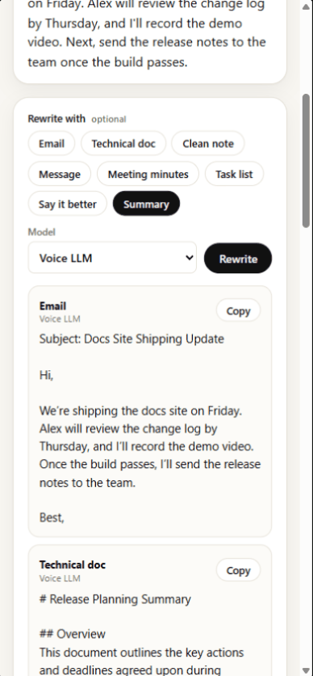
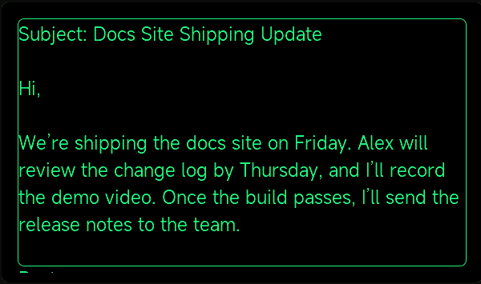
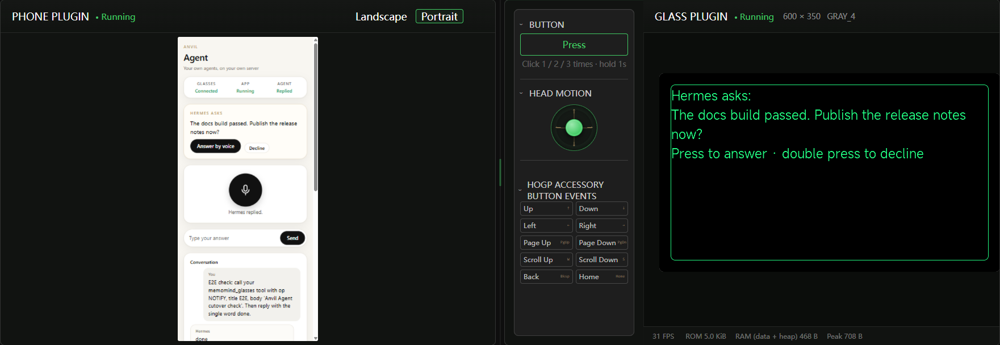

# MemoMind glasses

Two product families serve MemoMind One smart glasses from your own hosts:

- [Anvil Scribe](journeys/anvil-scribe.md) records memos and live captions,
  and rewrites a transcript on request as an email, a task list or minutes.
- [Anvil Agent](journeys/anvil-agent.md) lets you talk or type to your own
  agents and read the reply on the glasses. The agents can drive the glasses
  back through one MCP tool.

Each family pairs with a MemoMind web plugin, a small app that runs inside the
MemoMind phone app and draws on the glasses' 600x350 display. The plugins use
only the documented MemoMind PhoneSDK.

!!! info "Coming soon: the plugins are not published yet"
    The Anvil Scribe and Anvil Agent services ship in Anvil Serving today. Their
    MemoMind web plugins are not yet published in the MemoMind app, and their
    source is not public yet. Until then, you can run them in two ways:

    - **On your desktop:** in the MemoMind Plugin Studio simulator.
    - **On your own glasses:** through the MemoMind app's developer workspace,
      which needs a MemoMind developer account.

## What it looks like

These screenshots come from the MemoMind Plugin Studio simulator, connected to
live Scribe and Agent services. In each pair, the phone app is on the left or
first, and the glasses display follows.

**Anvil Scribe.** A dictated planning update, rewritten as an email with a
saved profile. The raw transcript stays above it. The
[Scribe walkthrough](journeys/anvil-scribe.md#a-walk-through-the-glasses-app)
covers every tab and profile.

**Anvil Agent.** An agent asks the wearer a question and waits for the answer.

## How the pieces fit

Both services listen on loopback, and one `tailscale serve` origin publishes
them, split by path:

| Path on the tailnet origin | Service |
| --- | --- |
| `/v1/memos` | Anvil Scribe |
| `/v1/agents`, `/v1/agent`, `/v1/hermes`, `/v1/glasses`, `/mcp` | Anvil Agent |

Requests reach a service only when:

- they come through `tailscale serve`;
- their `Tailscale-User-Login` header names an allowlisted login;
- any browser `Origin` they send matches the configured pattern.

Speech goes to Anvil Voice through the Capability Gateway, with a device key
bound to the speech-to-text route.

## Privacy and the MemoMind terms

- **No credentials in the plugins.** Agent and gateway credentials stay on the
  server, so a plugin has nothing to leak.
- **No microphone without a press.** When an agent asks for captions, a memo or
  an answer, the plugin only shows a request card. Nothing records until the
  wearer presses the glasses button.
- **Glasses audio and transcripts are user content.** They are never used to
  train, fine-tune or evaluate a model. Anvil Agent stores nothing. Anvil
  Scribe keeps its history in a private store that is excluded from
  evaluation.

## Set it up

1. Serve speech-to-text with [Anvil Voice](journeys/anvil-voice.md), and expose
   it through the [Capability Gateway](journeys/capability-gateway.md).
2. Deploy [Anvil Scribe](cli/scribe.md), [Anvil Agent](cli/agent.md), or both.
   Each one needs its own route-bound device key.
3. Publish their paths on one `tailscale serve` origin, using the table above.
4. Point the plugins at that origin once they are available.
