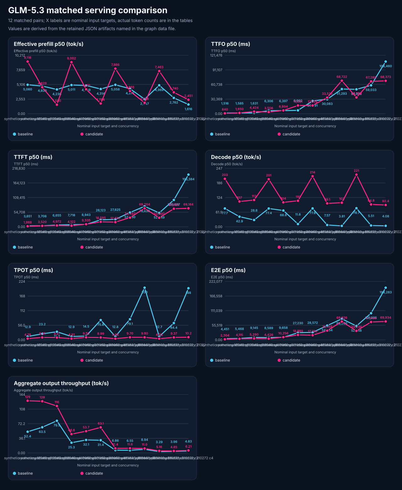

# GLM-5.3-Flash EXL3 versus NVIDIA FP4: serving performance

**Observed:** 2026-10-17. **Decision:** no promotion; exact retained r11 restored.

The NVIDIA recipe delivered faster single-request prefill and decode in this
test, with less sampled container RAM but less free GPU memory. Concurrent
latency was mixed. This is a comparison of two complete recipes on the same
two RTX PRO 6000 Blackwell Max-Q GPUs, not an isolated quantization or MTP test.

The completed scope contains **12 matched pairs, 84 successful scored requests
per arm**, and all 17 required metric families plus four supplemental families
for every accepted cell. The original 42-cell plan remains **closed partial:
24 accepted, one failed, 17 blocked, zero pending**. Both models overran the
strict controlled-output diagnostic, so that workload cannot support a valid
controlled-decode comparison. Natural-output and capacity-edge results below
remain separately useful; they do not erase that failure.

<!-- benchmark-result-card/v1 -->
## Result card

| Measurement | Retained EXL3 r11 | NVIDIA FP4 r2 |
|---|---:|---:|
| ~31.6K actual input, C1: effective prefill p50 | 5,011 tok/s | 9,002 tok/s |
| Same cell: first output / visible TTFT p50 | 6.31 / 7.72 s | 3.51 / 4.12 s |
| Same cell: decode p50 | 77.38 tok/s | 201.49 tok/s |
| Same cell: end-to-end p50 | 8.59 s | 4.43 s |
| ~31.6K actual input, C2: visible TTFT p50 | 8.94 s | 9.54 s |
| ~252.3K actual input, C4: visible TTFT p50 | 195.38 s | 69.18 s |
| Same C4 edge: aggregate output throughput | 4.83 tok/s | 6.21 tok/s |
| Runtime-reported KV token pool | 998,210 slots | 1,330,579 slots |
| Startup-reported KV allocation per GPU | 7.75 GiB, rounded | 7.12 GiB, rounded |
| Worst sampled GPU used / minimum free | 93.42 / 1.64 GiB | 94.19 / 0.87 GiB |
| Largest cell sampled cgroup memory | 51.89 GiB | 40.33 GiB |
| Accepted requests / OOM / preemption / refusal | 84 / 0 / 0 / 0 | 84 / 0 / 0 / 0 |

[Full p50/p95 timing, throughput, occupancy, and memory tables](2026-10-17-glm53-serving-performance-evidence/analysis/final-closed/comparison-tables.md)
· [machine-readable comparison](2026-10-17-glm53-serving-performance-evidence/analysis/final-closed/summary-table.json)
· [evidence index](2026-10-17-glm53-serving-performance-evidence/README.md)
· [coverage and terminal dispositions](2026-10-17-glm53-serving-performance-evidence/analysis/final-serving-comparison-evidence.json).

## Recipes and workload

| Property | Retained EXL3 | NVIDIA FP4 candidate |
|---|---|---|
| Checkpoint | `brandonmusic/GLM-5.3-Flash-tr3-4bpw` | `nvidia/GLM-5.3-Flash-FP4-Local` |
| Revision | `a5fee929cf4888b1824323e33e8a19b60129e025` | `76348ddb2be2e35e39ecfc00e75dc07703f4f3d5` |
| Runtime image | `verdictai/glm53-flash-exl3-k4:r19-sm120-tp2-ep2-dcp2-v84-language-only` | `ghcr.io/local-inference-lab/vllm:release-10152026` |
| Image digest | `sha256:0f1cdcc8891f1cc3a444121eb61d366289a1cbba285f0892dcbb24bc94961692` | `sha256:745feb916ee816f5409fd58386114be4f22fbede7f9c0e0a7b8c4fe8dac0fb29` |
| Weight format | EXL3 4 bpw | NVIDIA NVFP4/MXFP8 compressed scales |
| TP / DCP | 2 / 1 | 2 / 2 |
| KV / speculation | FP8 DSMLA / none | FP8 / MTP3 |
| Prefill batch token budget | 2,048 | 4,096; one parallel prefill |
| Configured context / sequences | 327,680 / 4 | 327,680 / 4 |
| Memory settings | fraction 0.97; 52 GiB container limit | fixed 7,650,410,496 KV bytes per GPU; fraction 0.985; 52 GiB container limit |
| Host residency | retained original recipe | `VLLM_GLM53_EMBED_HOST=1`; not strictly GPU-only |

The candidate follows the upstream recipe with local identity, pinned snapshot,
context/concurrency and containment settings. Exact rendered recipe observations
are retained in the evidence bundle. The image names alone are not topology:
the observed baseline uses DCP1 despite its image tag. Startup reports model-load
memory of 80.58 versus 82.73 GiB per GPU, separate from KV and total GPU use.

All accepted cells used maximum reasoning effort, temperature 0.6, top-p 0.95,
16,384 maximum completion tokens, unique-cache prompts and per-request canaries.
Each matched pair used the same seed, request indices, prompt namespace and
actual prompt-token vector. Reconstruction verifies the source fixture; it is
not a retained hash of the chat-template-serialized wire request.

Nine natural-output cells per arm used eight requests each at nominal
10,240/40,960/163,840 input targets and C1/C2/C4. Three capacity-edge cells per
arm used four requests each at nominal 310,272 and C1/C2/C4. Actual input medians
were approximately **7,682, 31,600, 134,358 and 252,300 tokens**. The graph labels
are nominal targets; the tables and native artifacts give actual tokens. Six
warmups and the separate diagnostic requests are excluded from scored totals.

## What the measurements establish

At C1, the candidate's median decode rate was approximately 201–221 tok/s
across these strata, versus 77–79 tok/s for EXL3. Its first-output and visible
TTFT medians were also lower. At ~31.6K, that corresponds to about 1.8 times the
effective prefill and 2.6 times the decode rate.

Queueing changes the result. At ~31.6K/C2 the candidate's median visible TTFT
and E2E were slightly worse, despite faster decode. At ~134.4K/C4, first output
was later (68.72 versus 51.29 s), while visible TTFT and completion were earlier.
The large concurrent decode ratios include scheduling stalls in the measured
interval; they are not claims about isolated kernel throughput. Output lengths
also vary naturally between arms, and the full table retains their distributions.

Both clients reached four overlapping requests. The engine sampled four active
requests on the baseline, versus two on the candidate at the medium/long/edge
C4 cells (three at the shortest stratum). Queued requests are measured separately.
This establishes successful bounded C4 client service, **not four fully resident
327K contexts**. At the largest C4 cell, sampled KV utilization peaked at
75.30% versus 26.54%; prefill staging, scheduling and queueing matter alongside
the candidate's 33.3% larger allocated token pool.

The candidate used less sampled cgroup memory but left only 0.87 GiB free on
the tightest GPU sample. Both recipes have narrow headroom. Cgroup memory
includes page cache and is not model-tensor RAM or total host RAM required.
Whole-host available memory is reported per cell; sequential cache history and
co-resident activity limit cross-arm attribution. The candidate's host embedding
setting also rules out a strict GPU-only claim. Zero OOM observations in these
bounded cells do not establish endurance or a safe production reserve.

## Definitions and evidence limits

TTFO is the first nonempty reasoning or visible output chunk; TTFT is the first
visible content chunk. Effective prefill is prompt tokens divided by TTFO and
therefore includes queueing, scheduling, cache effects and first-output work.
The table separately reports engine prefill and queue means from exact histogram
sum/count deltas. Decode is completion tokens after the first token divided by
the interval from TTFO to completion, including reasoning and scheduling stalls.
TPOT is a per-request aggregate proxy, not a raw token-arrival distribution.

The retained runner sampled engine telemetry every 0.5 s and GPU/host/cgroup
telemetry every 2 s, checked identity and cadence, and reconciled engine counters
to native request/token totals after drain. Sampled memory and occupancy maxima
are lower bounds on transient peaks. GPU figures are the worst single device,
not the sum of both GPUs. p50/p95 describe n=8 or n=4 populations; this run does
not establish stable p99, service-level tail latency, long-running stability,
full repository coding quality, or a maximum feasible concurrency.

MTP3 is part of the candidate recipe. No otherwise matched MTP-off arm ran, so
these results cannot isolate a speculation benefit. The earlier
[functional, image, synthetic-agentic and near-limit context campaign](2026-10-17-glm53-nvidia-fp4-ab.md)
remains separate. Its initial candidate context miss, unchanged successful
replays and largest successful 316,266-token prompt are not pooled into a
failure rate or a configuration-fix claim.

## Failures, fixes and restoration

The first controlled baseline cell exceeded its 1,200-second outer deadline.
Engine counters retained ten terminal responses: five stopped and five hit the
length limit. The old producer wrote its native artifact only after all futures
completed, so individual terminal timing rows were lost. No missing timing is
inferred from aggregate counters.

Paired one-request diagnostics reproduced the same strict output contract on
both recipes: each reached 16,384 completion tokens, with visible repetition
far beyond the requested 128 code words. The captured output was truncated at
8,192 characters and already contained 1,634 code words. This disproves a
reasoning-only starvation explanation. It does not identify a quantization,
MTP or configuration cause. Diagnostic timings are performance-ineligible;
the original controlled cells remain one failed and 17 blocked.

Four initial collection attempts—two warmups and two natural-output cells—were
excluded because their collector did not provide valid in-flight telemetry.
Their artifacts remain retained. The corrected runner passed its orchestration
fixture, the exact incumbent was restarted for fresh counters, and the accepted
cells were collected again. An early diagnostic output-parent precondition
failure was also retained with zero-request counter evidence.

The metric guard now binds all required families to the frozen matrix and native
observations. Missing measurements cannot be converted into a complete comparison.
Qualification, benchmark publication and Workbench instructions use that contract.
A post-campaign producer fix journals each terminal request with flush/fsync so
an interrupted run retains completed outcomes. Its overhead was not introduced
between these measured arms. A reusable numerical telemetry command remains a
separate [product follow-up](../../.tickets/2026-10-17-capacity-numerical-telemetry.md);
this campaign's reviewed collector is retained as evidence.

At **2026-10-17T13:03:57Z**, the candidate was absent, the exact retained r11
container and image were running, direct smoke/JSON passed 2/2, the router was
readmitted after identity readiness, and authenticated `llm.primary` smoke/JSON
passed 2/2. All 14 protected operator files were unchanged. The
[restoration receipt](2026-10-17-glm53-serving-performance-evidence/restoration/final-restoration-receipt.json)
binds these observations. No model was promoted; no reboot or fresh rebuild was
tested. Documentation and safeguards in this change do not imply a fleet rollout.
