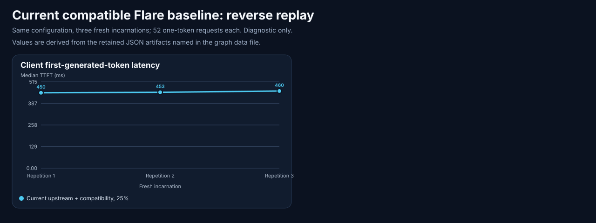

# Flare current-upstream baseline: compatibility restored, allocation question still open

**Date:** 2026-10-23 campaign; canonical measurements closed 2026-10-24 UTC.
**Decision:** `no-promotion`. Current upstream plus a minimal legacy-template compatibility patch completed the diagnostic baseline and restored the incumbent. No allocation change or 75% comparison ran.

<!-- benchmark-result-card/v1 -->
## Result card

The retained signed GLM-5.3-Flash package runs on the refreshed Flare source after an exact-byte legacy-template compatibility fix. Three complete 52-request reverse replays still exercise a mixture of host restores, GPU reuse and prefill; they do not establish a row-share speedup.

| Setup | Executed configuration |
| --- | --- |
| Model | `local-inference-lab/GLM-5.3-Flash-NVFP4-MXFP8-CSF-QAD`, revision `dec48abd33efa73c3bb7c95b74eee10cad34f9be`; served alias `glm53-flare-d5fd9824-compat-tp2-c4-mtp3`; canonical response identity separately pinned |
| Hardware | Two RTX PRO 6000 Blackwell Max-Q GPUs, TP2, historical configured 300 W limit each, not reverified during this run |
| Runtime | Upstream `d5fd9824` plus compatibility commit `0b21d7f`; image `sha256:b3c33bcf858d3764dbe155cbda5a006d364fa3a4309922bcb92e51e925c05804`; driver 615.71.10 |
| Recipe | [Retained reconstruction](2026-10-23-flare-upstream-refresh-evidence/reconstruction.md): unchanged 25% host-row allocation, 32 GiB host budget, 52 rows and 7,314 pages; fixed two draft tokens, adaptive verification off |
| Measurement | Managed direct online endpoint, serial requests; three fresh prime/reverse-replay incarnations and separate warm GPU-hit small12/pageheavy lanes |
| Contract | One completion token, reasoning effort max, requested temperature 0 and top_p 0.95; package temperature clamp means this is not a greedy-decoding claim. Frozen prompt/body bytes; configured concurrency four and workload ceiling 32,768 tokens are not simultaneous-capacity or native-context measurements |
| Evidence and decision | Bounded functional/compatibility evidence; performance qualification false; exact incumbent restored, no promotion |

| Headline observation | Result | Population |
| --- | ---: | --- |
| Completed canonical requests | 391 adapter + 1 smoke; zero failures | Six fresh incarnations; predecessor failures retained separately |
| Reverse-replay client first-generated-token TTFT medians | 449.93 / 452.90 / 460.25 ms | Three complete populations of 52 one-token requests |
| Host restores per reverse replay | 10 admitted and fetched | 52 host lookups, including 42 host-tier `no_match` outcomes |
| Warm small12 / pageheavy client first-generated-token TTFT | 9.382 / 18.065 ms | 24 / 12 measured requests; zero host fetches and prefill |
| Exact bounded matching | 192/192 | Prime/replay body hashes, prompt IDs and one-token output IDs; speculative work remains unknown |

**Why it matters:** the retained package can be investigated on the current upstream code without transplanting telemetry and retention changes already present upstream.

**Important caveat:** this is one configuration. The prior 128-token sampled-output equality failure remains unresolved, full speculative-work matching is unavailable, and the driver changed from 615.71.09. No historical 95–96% improvement is attributed to this refresh.

[Evidence index](2026-10-23-flare-upstream-refresh-evidence/README.md) · [artifact manifest](2026-10-23-flare-upstream-refresh-evidence/artifact-manifest.json) · [authoritative summary](2026-10-23-flare-upstream-refresh-evidence/summary.json)

## Source and compatibility scope

The [upstream review](2026-10-23-flare-upstream-refresh-evidence/upstream-review.md) and retained issue/PR snapshots precede the experiment. The compatibility change adds GLM to the existing exact-byte legacy-template upgrader; altered unknown templates continue to fail closed. It does not change package graphs, weights, sampling or the host-cache allocator. Signed loading and stored-data verification remain enabled. This was compatible upstream plus a local patch, not an unmodified-upstream measurement.

The configured catalog alias identifies the request-facing model. The catalog root and model-bearing response events use the canonical package ID. The collector now pins each role independently; the earlier rejected fixture is retained as a collector-contract failure, not a proven server-response bug.

## Workload and measurements

The canonical count is four fixtures, 15 warmups, 180 prime requests and 192 measured requests, totaling 391 adapter requests, plus one smoke. Each fixed1 repetition used a fresh incarnation, three warmups, 52 prime requests and 52 reverse-replay requests. The protected small12 lane used three warmups, 12 prime and 24 measured requests; pageheavy used three warmups, 12 prime and 12 measured requests. The initial fixture/smoke incarnation is separate.

TTFT is the client time to the first generated-token event in milliseconds, summarized over each complete measured population. It is distinct from client end-to-end time and visible-text latency. The table and chart are descriptive same-configuration observations, not an A/B estimate. Small protected populations do not establish stable tail latency.

| Reverse replay | Measured requests | Median client first-generated-token TTFT (ms) | Host fetches | Host-tier no_match | Prefill tokens | Host-cache reused tokens |
| --- | ---: | ---: | ---: | ---: | ---: | ---: |
| 1 | 52 | 449.93 | 10 | 42 | 199,464 | 76,848 |
| 2 | 52 | 452.90 | 10 | 42 | 199,464 | 76,848 |
| 3 | 52 | 460.25 | 10 | 42 | 199,464 | 76,848 |

[Graph values and source hashes](2026-10-23-flare-upstream-refresh-evidence/graphs/replay-data.json) retain the exact numeric paths. The protected warm conditions are excluded from this repetition chart: small12 and pageheavy measured zero host fetches and zero prefill, with GPU-prefix reuse. Native host-tier `no_match` can include a GPU hit; it does **not** mean every such request recomputed its prefix. Host-cache reused tokens are not total/GPU-cache reused tokens.

Current native reason-labelled host counters are retained. Row/page-pressure counters from the old local instrumentation are not synthesized, so this run alone cannot attribute remaining misses to row capacity. Full per-request speculative work is unobserved and remains unknown even when one-token outputs match.

## Failures, restoration and limits

Three predecessor windows remain archived: a driver-library/kernel mismatch after a system update; a healthy launch whose versioned engine lacked a declared monitoring mapping; and a fixture rejected because the collector expected the advertised alias in a canonical-ID response. The initial summary reader's fixture-binding rejection and subsequent independent reviews also remain retained. Corrections did not rewrite those failures as passes. The [friction log](2026-10-23-flare-upstream-refresh-evidence/friction-log.md) distinguishes operational recovery, collector repairs and the open monitoring-preflight product ticket.

Canonical closeout restored the exact retained incumbent with no experiment or recovery error. Direct and routed preflights each passed seven groups and 27 observations, including 20 tool probes and the two tool-result stages. Readmission, fresh monitoring, containment, zero restarts/OOM and final inventory checks passed. These are dated restoration observations, not a claim of future health.

No 75% arm, current long-output quality test, complete numerical oracle, causal old-versus-new comparison or promotion ran. The driver and upstream changes prevent attributing an apparent historical timing difference to one code change. The earlier sampled-output equality failure and held protected-performance gates remain historical evidence. A future matched allocation comparison and numerical component oracle require their own declared experiments; this finding grants neither deployment nor upstream-submission authority.

## Proposed contributions

The [compatibility PR draft](2026-10-23-flare-upstream-refresh-evidence/compatibility-pr-draft.md) and [exact patch](2026-10-23-flare-upstream-refresh-evidence/legacy-glm-template-compat.diff) are ready for review. The separate [cache issue draft](2026-10-23-flare-upstream-refresh-evidence/issue-draft.md) records the residual question and existing upstream work without claiming an unrun 25%/75% result. These are proposed messages; nothing has been submitted upstream.

## Evidence

The [complete index](2026-10-23-flare-upstream-refresh-evidence/README.md) links native raw archives, failures and restoration. The accepted full reader summary and its rejected predecessor are compressed separately, with per-source and archive-member hashes in [provenance](2026-10-23-flare-upstream-refresh-evidence/provenance.json). Raw schemas remain unchanged; sanitized public bytes have their own hashes. No source patch was sent upstream as part of this publication.
