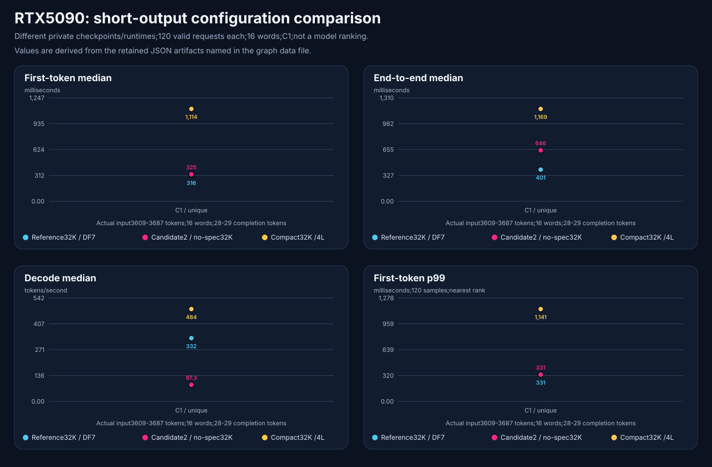

# RTX 5090: three candidate families, useful tuning, no promotion

**Date:** 2026-11-03. **Scope:** one RTX 5090, Windows/Docker Linux VM,
direct online endpoints; bounded coding and synthetic capability tests.
**Decision:** challenger evidence, **no-promotion**.

<!-- benchmark-result-card/v1 -->
## Result card

> Three candidate families each produced a configuration that passed the local
> coding fixture. The campaign did not qualify an equivalent replacement for
> the reference service.

| Setup | Recorded value |
|---|---|
| Models | Private candidate on Ignis; QAT candidate; coding-focused candidate; private reference. Exact variants and asset fingerprints withheld. |
| Hardware | One RTX 5090, 32 GB class; no other GPU measured |
| Runtime and recipe | Ignis 0.8.0 and separate NInfer configurations; [sanitized controls](2026-11-03-rtx5090-campaign-evidence/configuration.md) |
| Measurement path | Direct online requests; repeated prompts with observed prefix reuse, not cold-only |
| Coding contract | Seven Python task types × three repetitions; 21 solutions and 123 behavioral checks per profile; temperature 0, total completion cap 12,288 |
| Context/modality | Configurations differ: 128K text, 160K text or image, and 256K image; primary requests sequential C1 |
| Evidence | Bounded quality, functional and capacity diagnostics; full serving comparison incomplete |
| Decision | No promotion; declared reference policy restored at campaign close |

| Headline measurement | Local result | Conditions |
|---|---:|---|
| Fresh coding candidate | **123/123 checks; 21/21 solutions** | 128K configured, text-only, fresh process; median task latency **0.886 s** |
| Restored reference | **114/123 checks; 15/21 solutions** | 160K configured, vision enabled; median task latency **1.399 s** |
| Ignis budget follow-up | **111/123 → 123/123** | Matched 32K controls except thinking budget 1,024 → 4,096; summed task latency **99.145 → 305.500 s** |
| Ignis larger-profile retrieval | **45/45** | Sequential synthetic cases through **245,646 actual input tokens**, configured 262,144; reasoning disabled |
| Ignis image assertions | **18/18** | Seven synthetic images, six types × three repeats; incidental unsupported claims remain |
| Negative result | QAT vision startup failed | Text-only sibling passed; no vision qualification transfers |

Values derive from the [summary](2026-11-03-rtx5090-campaign-evidence/summary.json)
and [all coding cohorts with native links](2026-11-03-rtx5090-campaign-evidence/coding-results.md).

**Why it matters:** the coding candidate deserves a held-out coding follow-up;
Ignis offers useful bounded context/image behavior, with a material reasoning
budget tradeoff. Faster settings sometimes broke correctness.

**Important caveat:** checkpoint, runtime, reasoning, context and modality differ.
This is not a general model or engine ranking, a complete serving comparison,
or an equivalent-main replacement result. Public identity/text redactions also
prevent independent exact replay.

[Artifact manifest](2026-11-03-rtx5090-campaign-evidence/artifact-manifest.json) ·
[Evidence index](2026-11-03-rtx5090-campaign-evidence/README.md) ·
[Publication summary](2026-11-03-rtx5090-campaign-evidence/publication-summary.md) ·
[Ignis use and improvement note](2026-11-03-ignis-improvements.md)

## Outcome and decision

The fresh 128K coding candidate passed every fixture check with lower observed
task latency than the restored 160K image-capable reference. That comparison
does not establish vision parity, a matching context envelope, repository repair,
or superior performance on other workloads. It supports a focused next trial.

The compact Ignis profile and QAT no-speculation profile also passed all coding
checks, with higher task latency. QAT speculative settings scored 120/123 and
117/123; returning to no speculation recovered 123/123 and identical visible
sources to its original control. Speculation and proposal-head/load-path changes
are coupled, so this is not a general numerical-mechanism claim.

All campaign test containers were unloaded and the declared reference policy
was restored. Exact pre-campaign immutable capture was incomplete: restoration
proves declared policy and a fresh observed process, not equality to an
uncaptured original container. This publication makes no live deployment claim.

## Configuration and method

The [configuration description](2026-11-03-rtx5090-campaign-evidence/configuration.md)
separates profiles and request-level reasoning modes.
The [run map](2026-11-03-rtx5090-campaign-evidence/run-plan.md) is retrospective,
not a fabricated pre-request plan.

The seven-task list is in the
[workload manifest](2026-11-03-rtx5090-campaign-evidence/workload-manifest.json).
Generated Python was reviewed before execution with an AST allowlist, an
independent deterministic behavioral oracle, isolated child process, two-second
deadline and 256 MiB OS limit. Those controls are not a security sandbox.
Model self-assessment was not the acceptance gate.

Seven repeated task types are not 21 independent tasks. Temperature zero and
prefix reuse produced repeated identical answers. The 4,096 visible plus 8,192
reasoning headroom fields describe one total completion cap; they do not hard
partition its channels. Post-hoc supplemental checks do not increase the frozen
123-case score. Latencies describe requests actually run, including their
different answer/reasoning lengths and policies.

## Context, tool-use and images

| Profile | Retrieval | Synthetic tool-use | Image assertions | Boundary |
|---|---|---|---|---|
| Ignis 256K vision | 45/45; maximum input 245,646 | 30/30, reasoning enabled | 18/18 | Retrieval/images reasoning disabled; no simultaneous full-window test |
| QAT 160K text | 45/45; maximum input 155,526 | 30/30, reasoning disabled | Unrun | Vision-enabled sibling failed startup |
| Coding candidate, earlier 128K process | 225/225 raw; maximum input 122,771 | 30/30 | Unqualified | Outer context job failed packaging; fresh coding recheck is a different process |
| Restored 160K reference | 15/15; maximum input 155,526 | 30/30 | 18/18 | Launch thinking off; native default/no override; near-boundary checks only |

Native evidence:
[Ignis retrieval](2026-11-03-rtx5090-campaign-evidence/raw/ignis-256k-vision-context-raw.json),
[tool-use](2026-11-03-rtx5090-campaign-evidence/raw/ignis-256k-vision-agentic-raw.json),
[images](2026-11-03-rtx5090-campaign-evidence/raw/ignis-256k-vision-multimodal.json),
[QAT retrieval](2026-11-03-rtx5090-campaign-evidence/raw/qat-text160k-context-raw.json),
[tool-use](2026-11-03-rtx5090-campaign-evidence/raw/qat-text160k-agentic-raw.json),
[earlier coding retrieval](2026-11-03-rtx5090-campaign-evidence/raw/coding-candidate-128k-context-raw.json),
[failed outer job](2026-11-03-rtx5090-campaign-evidence/raw/coding-candidate-128k-context-artifact.json),
[tool-use](2026-11-03-rtx5090-campaign-evidence/raw/coding-candidate-128k-agentic-deep-raw.json),
[reference retrieval](2026-11-03-rtx5090-campaign-evidence/raw/reference-restored-context-raw.json),
[tool-use](2026-11-03-rtx5090-campaign-evidence/raw/reference-restored-agentic-raw.json),
[images](2026-11-03-rtx5090-campaign-evidence/raw/reference-restored-multimodal.json).

Large-profile retrieval uses one repetition per case type, position and bucket.
It tests synthetic retrieval, not long-context reasoning. Tool sessions comprise
short messages, not repository work. Image scores grade required facts rather
than every incidental statement: Ignis added unsupported sales and industrial
interpretations; the reference also made a spatial-caption error.

## Separate short-output capacity diagnostics

The [source-derived chart data](2026-11-03-rtx5090-campaign-evidence/capacity-graph-data.json)
retains three distinct 32K profiles with 120 eligible requests each, unique
prefixes, canaries, 16 exact words, and roughly 3.6K actual input tokens.
Ignis reports 28 completion tokens; the two NInfer cells report 29. Native
rates use each runtime's token counts. This is not a matched engine experiment
or a sustained long-output estimate. The 32K reference is **not** the restored
160K reference in the coding table.

Original 128-word cells had no eligible requests. The separate 16-word workload
does not rescue those failed cells. Functional serial/overlap stability checks
are performance-ineligible and do not prove scheduler concurrency. No general
latency SLO is established.

## Failures and remaining work

- **QAT vision:** earliest actionable startup error was “bf16 linear:
  unsupported shape”; exit 1, no OOM kill. The exact failing tensor is unknown.
  This is a pinned-runtime/profile failure, not proof against every variant.
- **Ignis budget:** 1,024 tokens repeated topological-order and zero-capacity
  cache errors; 4,096 recovered this suite. No universal optimal budget follows.
- **Harness:** lexical keyword checks accepted a wrong arithmetic answer and
  were excluded from correctness. Explicit tokenizer protocols and compact
  context summaries required local fixes; later passes do not rewrite failures.
- **Coverage:** no repository-task score, routed-client acceptance, video,
  exact maximum-context boundary, concurrent full contexts or endurance result.
- **Publication:** identities and output text are deliberately withheld;
  schemas and numeric states are retained, but public independent replay
  is limited. See the [redaction ledger](2026-11-03-rtx5090-campaign-evidence/redaction-ledger.json).

Next work should use held-out repository tasks and declared capability parity,
then a fully frozen serving matrix with matched policies and eligible outputs.
Those are proposed experiments, not completed work or promotion authority.

The [friction log](2026-11-03-rtx5090-campaign-evidence/friction-log.md) records
the chart annotation correction and durable/open dispositions.
The [restoration receipt](2026-11-03-rtx5090-campaign-evidence/restoration.json)
and [final checks](2026-11-03-rtx5090-campaign-evidence/raw/restoration-final-health.json)
retain the historical ending state. Publication performed no serving action.
