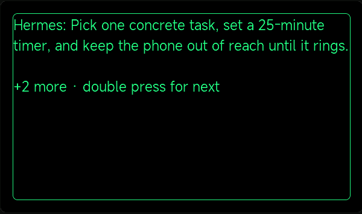

# Anvil Agent

Anvil Agent connects smart glasses to your own agents. Talk or type to an agent
and read its reply on the HUD; the agent can show you cards, run a
teleprompter or ask you a question through one MCP tool. Speech goes through
the gateway with a route-bound key, agent credentials stay on your host, and
nothing is stored.

<!-- product-journey:anvil-agent -->

!!! info "Coming soon on MemoMind glasses"
    The MemoMind web plugin for this family is not published yet. See
    [MemoMind glasses](../MEMOMIND-GLASSES.md) for how to try it today.

## When to use it

- You wear glasses with a small display and want your own agent a press away.
- You want an agent to put a card, a script or a question in front of you.
- Speech and agent credentials must stay on your own hosts.

## What the wearer sees

These screenshots come from the MemoMind Plugin Studio simulator, running the
Anvil Agent web plugin against a live Anvil Agent service.

An agent's reply shows on the glasses in at most two short sentences:

## Go deeper

- Command reference: [agent](../cli/agent.md)
- [ADR-0049](../adr/0049-anvil-agent-glasses-bridge.md): why Anvil Agent is its own family
- The gateway's audio grants: [router keys](../cli/router.md)
