# Anvil Scribe

Anvil Scribe is record-first dictation. It saves the raw transcript of every
recording, then rewrites it only when you ask, with a saved profile on a model
you choose, and keeps the raw text and every rewrite in a private history. It
consumes Anvil Voice speech-to-text and the gateway's chat aliases through one
route-bound key.

<!-- product-journey:anvil-scribe -->

!!! info "Coming soon on MemoMind glasses"
    The MemoMind web plugin for this family is not published yet. See
    [MemoMind glasses](../MEMOMIND-GLASSES.md) for how to try it today.

## When to use it

- You dictate from a phone, glasses or browser and want the words kept exactly.
- You want the same memo as an email, a task list or minutes, on demand.
- Recordings and transcripts must stay on your own hosts and out of evaluation.

## A walk through the glasses app

These screenshots come from one session in the MemoMind Plugin Studio
simulator, running against a live Scribe service. The app has three tabs:
Record, History and Profiles. The glasses display is 600x350.

### Record

Tap the mic, or press the glasses button, and speak. The transcript appears as
you talk, on the phone and on the glasses. Press again to stop and save, or
double-press to cancel, which saves nothing.

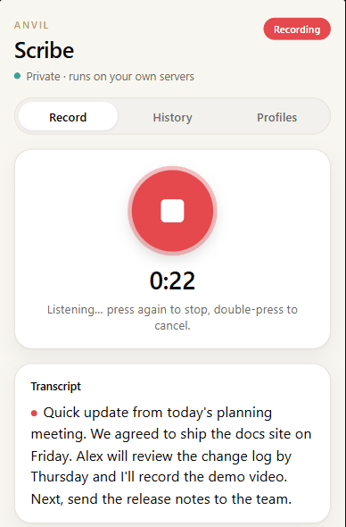
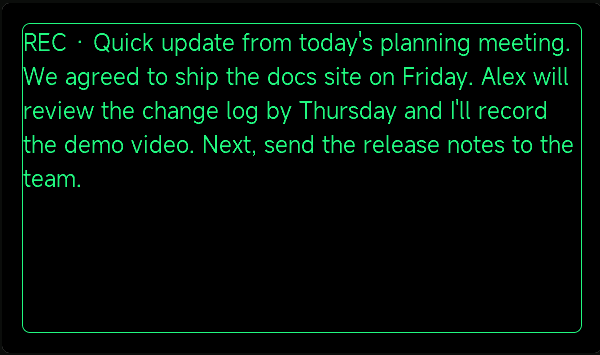

Scribe saves the raw transcript first, exactly as you said it. Then pick a
profile, choose a model and tap Rewrite. Each rewrite is added below the
transcript with its own Copy button. The latest result also shows on the
glasses. A long result is split into pages with a footer such as "1/2 · hold:
next page". Holding the glasses button shows the next page; when no result is
showing, it brings back the latest one.

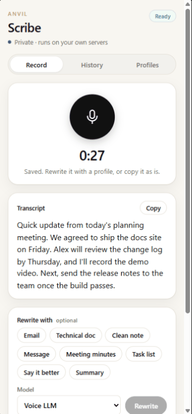
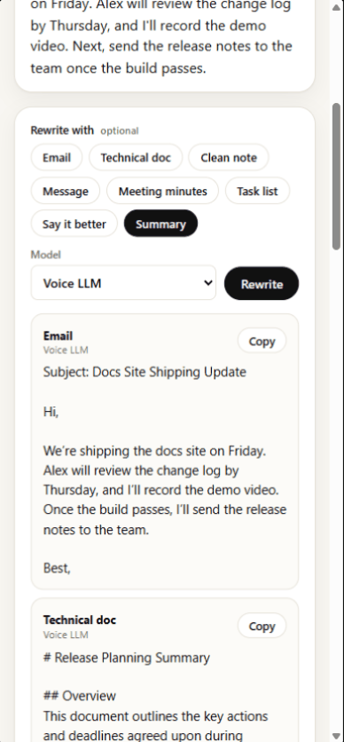

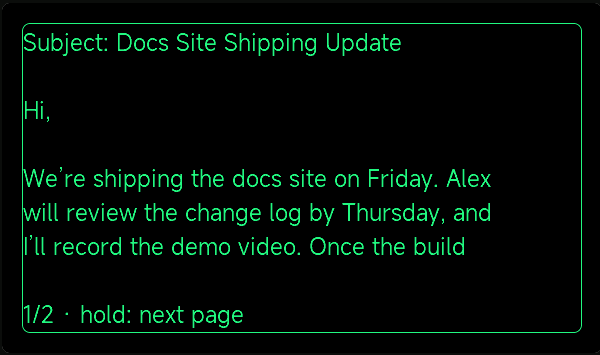
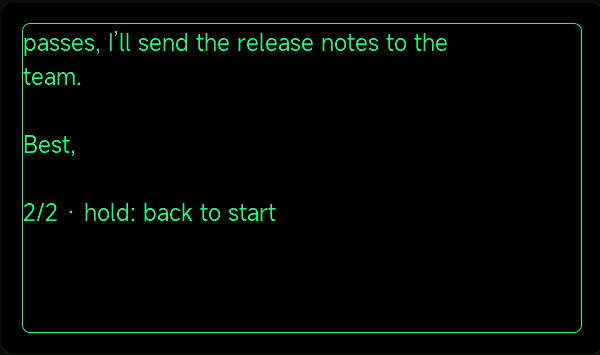

The same memo, rewritten by each built-in profile. Each image shows the first
page:

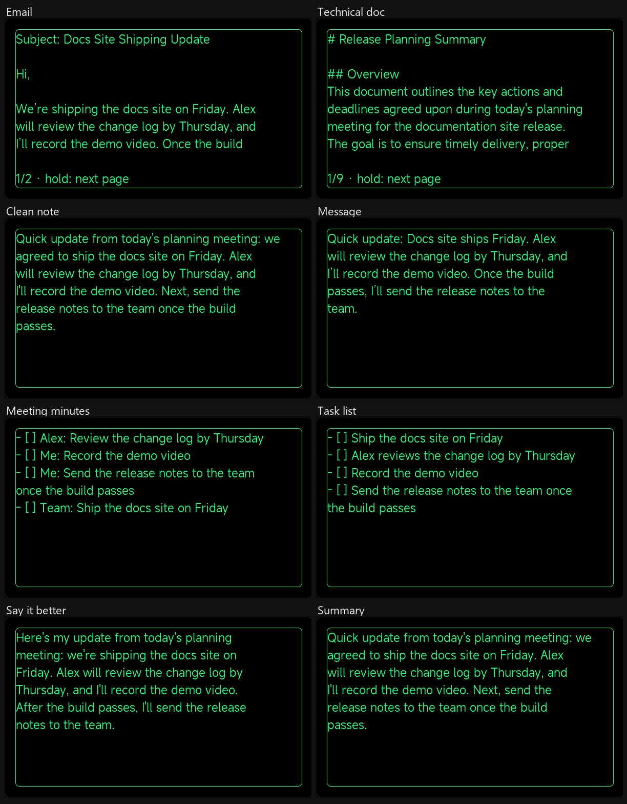

### History

Every recording is kept with its length and rewrite count. Tap one to see the
original transcript and every rewrite made from it.

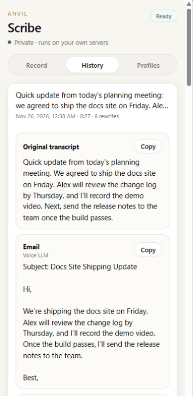

### Profiles

The eight built-in profiles are read-only. Open one to read its prompt, or
duplicate it as a custom profile and adjust it. "New profile" takes a name, a
description, a prompt and a default model.

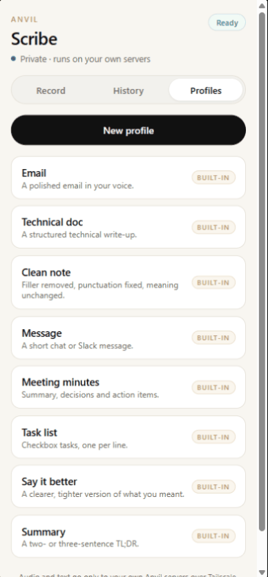
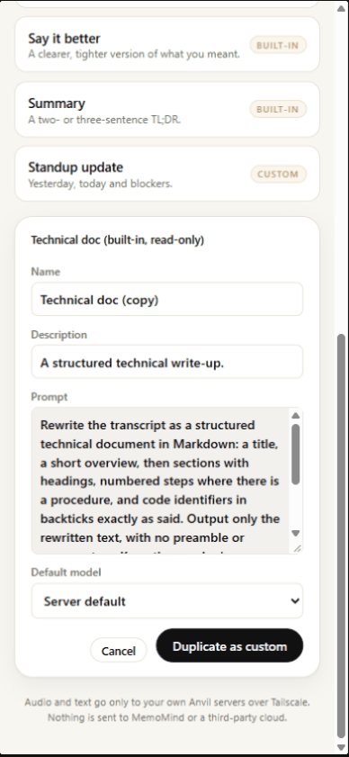
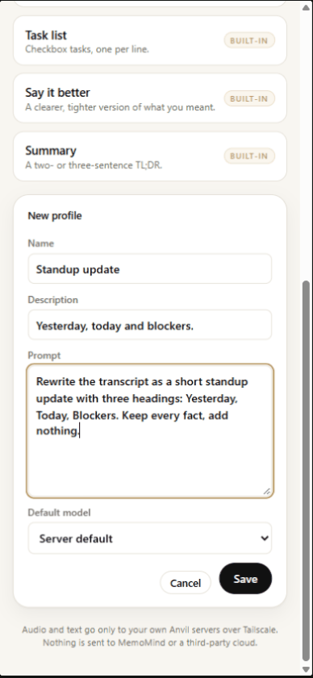

A saved custom profile appears next to the built-ins as a rewrite option:

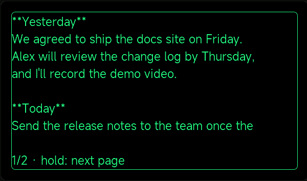

## Go deeper

- Command reference: [scribe](../cli/scribe.md)
- [ADR-0048](../adr/0048-anvil-scribe-record-first-dictation.md): why Scribe is a gateway client
- The gateway's audio grants: [router keys](../cli/router.md)
